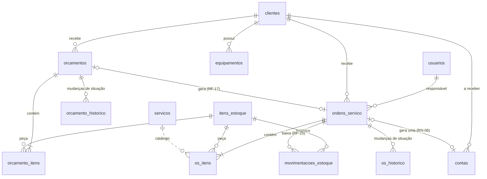

# GesTI · aplicativo (Etapa 4)

Versão inicial do GesTI, desenvolvida a partir das 13 telas do [protótipo](../prototipo/README.md) e dos [requisitos da Etapa 3](../docs/etapa3/requisitos.md).

Aplicação web em **Python 3 + Flask**, com banco **SQLite** (um arquivo, sem servidor de banco) e interface em HTML/CSS/JavaScript sem frameworks. Roda em qualquer computador com Python instalado.

## Como rodar

```bash
cd src
python -m pip install -r requirements.txt   # instala o Flask
python run.py
```

Abra **http://127.0.0.1:5000** no navegador.

Na primeira execução o banco é criado em `src/instance/gesti.db` e preenchido com os dados de exemplo da NexaHertz (os mesmos do protótipo). As datas dos exemplos são calculadas a partir do dia em que o banco foi criado.

### Usuários de demonstração

Senha de todos: `gesti123`

| Perfil | E-mail | Acesso |
| --- | --- | --- |
| Administrador | rodrigo@nexahertz.com.br | Tudo, inclusive Financeiro, Relatórios e Configurações |
| Técnico | ana@nexahertz.com.br (também carlos@ e bruno@) | OS, estoque e consultas; sem Financeiro |
| Atendente | juliana@nexahertz.com.br | Clientes, orçamentos e OS; sem Financeiro |

### Recriar o banco

```bash
cd src
python -m flask --app run init-db              # apaga e recria com os dados de exemplo
python -m flask --app run init-db --sem-dados  # banco vazio (só o esquema)
```

O banco vazio não tem usuários. Para criar o primeiro administrador, use o banco com dados de exemplo e cadastre os usuários reais em **Configurações**.

### Testes automatizados

```bash
cd src
python -m unittest discover -s tests -v
```

São 15 testes. Eles cobrem o fluxo integrado completo e as principais regras de negócio (veja a tabela abaixo).

## Estrutura

```
src/
├── run.py                 # ponto de entrada (python run.py)
├── requirements.txt
├── tests/test_gesti.py    # testes automatizados
└── gesti/
    ├── __init__.py        # cria a aplicação Flask e registra os módulos
    ├── schema.sql         # modelo de dados (tabelas, chaves e restrições)
    ├── db.py              # conexão SQLite e comando init-db
    ├── seed.py            # dados de exemplo da NexaHertz
    ├── auth.py            # login, perfis e proteção CSRF
    ├── regras.py          # regras de negócio que cruzam módulos
    ├── util.py            # formatação BR, validação de CPF/CNPJ, situações
    ├── views/             # uma camada por módulo
    │   ├── dashboard.py   clientes.py   orcamentos.py   ordens.py
    │   ├── estoque.py     financeiro.py relatorios.py   configuracoes.py
    │   └── busca.py
    ├── templates/         # telas (HTML com Jinja), uma pasta por módulo
    └── static/            # app.css (visual do protótipo) e app.js
```

Organização em camadas:

- **views/**: recebem a requisição, validam o formulário e escolhem a tela.
- **regras.py**: concentra as regras que envolvem mais de um módulo (baixa de estoque, conversão de orçamento em OS, conclusão de OS com conta a receber). As funções não gravam sozinhas: quem chama abre uma transação com `with db:`. Assim a operação inteira é gravada ou nada é (RNF-14).
- **templates/**: telas fiéis ao protótipo.

## Modelo de dados



| Tabela | Conteúdo |
| --- | --- |
| `usuarios` | Login, senha com hash e perfil (admin, técnico, atendente) |
| `clientes` | Cadastro PF/PJ, contato, endereço, status, autoria |
| `equipamentos` | Equipamentos de cada cliente, reaproveitados em orçamentos e OS |
| `servicos` | Catálogo de serviços com preço padrão |
| `itens_estoque` | Peças e equipamentos à venda; `quantidade` nunca fica negativa (CHECK) |
| `movimentacoes_estoque` | Entradas, saídas e ajustes com saldo após cada lançamento |
| `orcamentos` / `orcamento_itens` / `orcamento_historico` | Orçamento, itens e data de cada mudança de situação |
| `ordens_servico` / `os_itens` / `os_historico` | OS, serviços e peças lançados e histórico de situação |
| `contas` | Contas a receber e a pagar; `os_id` é único, então cada OS gera no máximo uma conta |

As tabelas principais guardam `criado_em`, `criado_por`, `atualizado_em` e `atualizado_por` (RF-04).

## Requisitos atendidos nesta versão

| Requisito | Onde está |
| --- | --- |
| RF-01 Login por e-mail e senha | `auth.py`, tela de login |
| RF-02 / RNF-11 Permissão por perfil, validada no servidor | `auth.perfil`; Financeiro, Relatórios e Configurações só para o administrador |
| RF-03 Busca global | Barra superior (atalho Ctrl+K); "OS-0235" ou "ORC-0148" abre o registro direto |
| RF-04 Autoria e datas | Colunas `criado_*` / `atualizado_*` |
| RF-05 a RF-08 Cadastro, validação, edição, inativação e lista de clientes | Clientes; CPF/CNPJ validados pelos dígitos verificadores; CEP preenche o endereço (ViaCEP) |
| RF-09 Histórico de relacionamento | Ficha do cliente → Visão geral |
| RF-10 Equipamentos do cliente | Aba Equipamentos; escolha em orçamentos e OS |
| RF-11 Orçamento/OS a partir da ficha | Botões "+ Novo orçamento" e "+ Nova OS" |
| RF-12 a RF-18 Orçamentos | Itens de serviço, peça e avulso; totais automáticos; etapas com datas; conversão em OS |
| RF-19 Orçamento em PDF | "Imprimir / PDF" (versão para impressão; salvar como PDF pelo navegador) |
| RF-20 a RF-27 Ordens de serviço | Quadro kanban com arrastar e soltar, lista, OS avulsa, laudo, peças com baixa automática, finalização |
| RF-28 a RF-33 Estoque | SKU automático, situação calculada, entradas/saídas/ajustes, histórico, alertas |
| RF-34 a RF-39 Financeiro | Conta a receber gerada pela OS, lançamentos manuais, "Marcar como pago", atraso automático, filtros e indicadores |
| RF-40 a RF-42 Dashboard | Indicadores, recentes, resumo do mês, alertas e atalhos |
| RF-43 Exportação | CSV (abre no Excel) de contas, OS e estoque; tela de Relatórios |
| RN-02 Só orçamento aprovado vira OS | `regras.converter_orcamento_em_os` (testado) |
| RN-03 Desconto ≤ subtotal | `regras.calcular_totais` e tela da OS (testado) |
| RN-04 Saldo não negativo | Checagem em `movimentar_estoque` + CHECK no banco (testado) |
| RN-05 Estoque baixo / sem estoque | `util.status_estoque` |
| RN-06 Uma conta por OS | Coluna única `contas.os_id` + reabrir/concluir atualiza a mesma conta (testado) |
| RN-07 Cliente com movimentação não é excluído | `clientes.excluir` (testado) |
| RN-08 Conta em atraso | `util.status_conta` |
| RN-09 OS concluída só o admin altera | `regras.os_editavel` (testado) |
| RNF-04 / RNF-05 Mensagens em português, R$ e dd/mm/aaaa | `util.py`, mensagens indicam o campo |
| RNF-09 Senha com hash e salt | `werkzeug.security` (scrypt) |
| RNF-10 Sessão expira em 30 min | `PERMANENT_SESSION_LIFETIME`; cookie seguro com `GESTI_HTTPS=1` |
| RNF-12 LGPD | Anonimização de cliente inativo (administrador) |
| RNF-14 Operações transacionais | `with db:` em toda operação entre módulos (testado) |
| RNF-16 Responsivo | Menu recolhível e layout em uma coluna no celular |
| RNF-17 Base relacional única | SQLite com chaves estrangeiras ativas |

### Ainda não implementado (próximas etapas)

- **RNF-13 Backup diário**: com SQLite, basta copiar o arquivo `instance/gesti.db`. Falta agendar essa cópia no servidor (ex.: Agendador de Tarefas do Windows ou `cron`).
- **RNF-10 HTTPS**: depende de onde o sistema será publicado (ex.: atrás de um proxy com certificado). Defina `GESTI_HTTPS=1` em produção.
- Envio do orçamento por e-mail/WhatsApp direto do sistema (ponto em aberto com a NexaHertz).

## Configuração (variáveis de ambiente, opcionais)

| Variável | Padrão | Uso |
| --- | --- | --- |
| `GESTI_SECRET_KEY` | gerada em `instance/secret_key` | Chave da sessão |
| `GESTI_DATABASE` | `instance/gesti.db` | Caminho do banco |
| `GESTI_EMPRESA` / `GESTI_EMPRESA_SIGLA` | NexaHertz / NH | Nome exibido no menu |
| `GESTI_HTTPS` | — | `1` para exigir cookie seguro (produção com HTTPS) |
| `GESTI_DEBUG` | `1` | `0` para desligar o modo de depuração |
